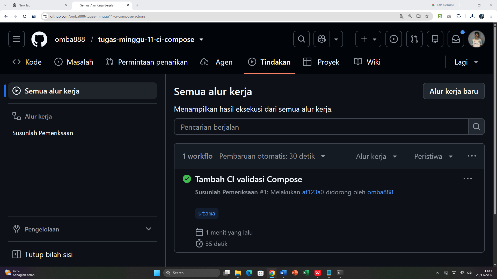
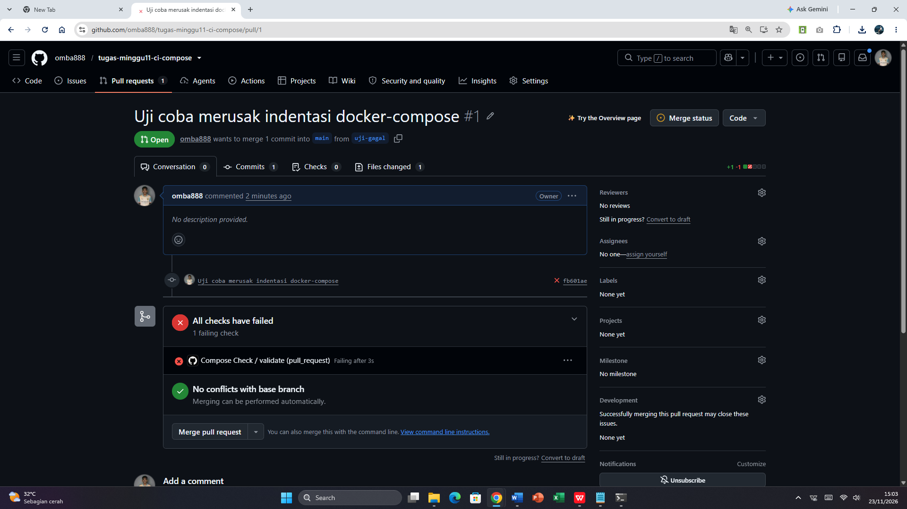
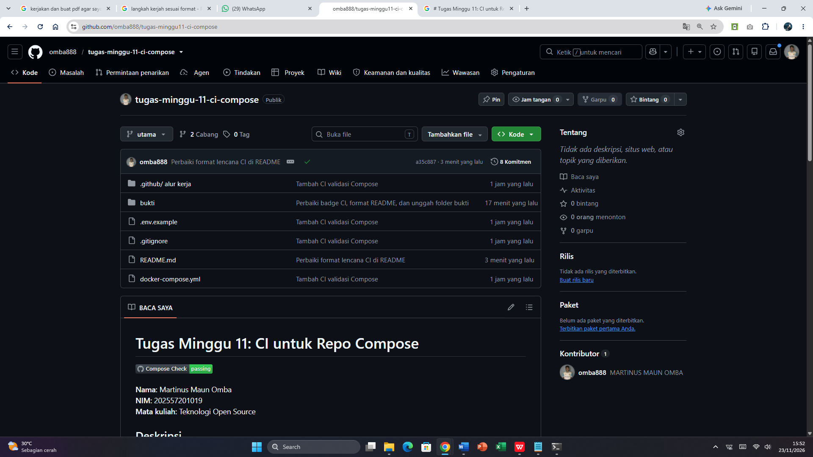

# Tugas Minggu 11: CI untuk Repo Compose

**Nama:** Martinus Maun Omba  
**NIM:** 202557201019  
**Mata kuliah:** Teknologi Open Source

## Deskripsi
Workflow ini memvalidasi sintaks dan konfigurasi file `docker-compose.yml` secara otomatis menggunakan GitHub Actions setiap kali ada `push` ke branch `main` atau ketika `pull_request` dibuat/diperbarui.

## Isi repositori
- `.github/workflows/compose-check.yml` : workflow CI
- `docker-compose.yml` : stack WordPress + MariaDB (tugas minggu 10)
- `.env.example` : contoh variabel lingkungan tanpa rahasia asli
- `.gitignore` : mengabaikan `.env`

## Cara kerja workflow
Workflow dipicu oleh event `push` ke `main` dan `pull_request`. Di dalamnya terdapat satu job bernama `validate` yang berjalan di runner `ubuntu-latest` dengan langkah utama: mengunduh kode repo (`checkout`), menyalin `.env.example` menjadi `.env`, mengecek validitas konfigurasi Docker Compose dengan perintah `docker compose config -q`, serta menguji siklus hidup container (`up -d`, `ps`, dan `down`).

## Bukti
1. Run hijau di tab Actions  
   
2. Pull Request dengan check gagal (merah)  
   
3. Badge status di README  
   

Tautan Pull Request (sudah hijau dan di-merge): https://github.com

## Kendala dan cara mengatasinya
Saat melakukan uji gagal pada Pull Request, muncul error `yaml: line 17: did not find expected key` pada log step validasi karena indentasi baris `image:` dikurangi satu spasi. Masalah diatasi dengan mengembalikan spasi indentasi sesuai standar YAML (2 spasi) lalu melakukan commit dan push ulang.

## Refleksi singkat
Penerapan CI sangat membantu mendeteksi kesalahan sintaks atau konfigurasi sejak dini sebelum kode digabungkan ke branch utama, sehingga mencegah kerusakan pada lingkungan produksi maupun kolaborasi tim.
